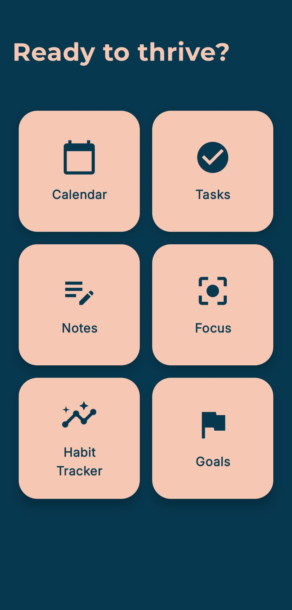
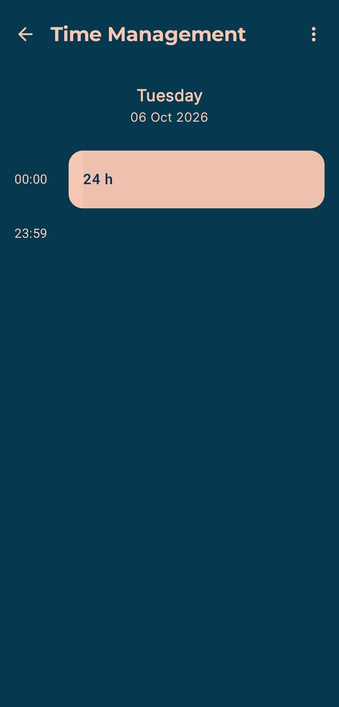
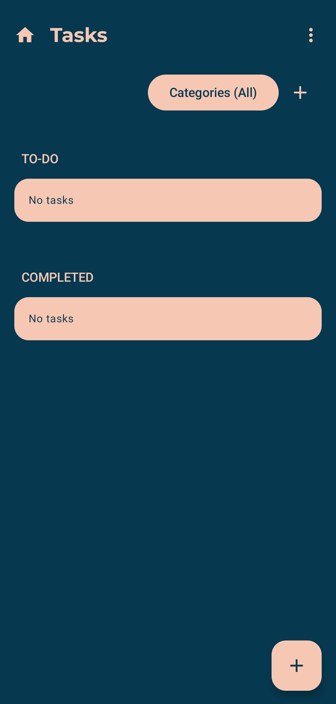
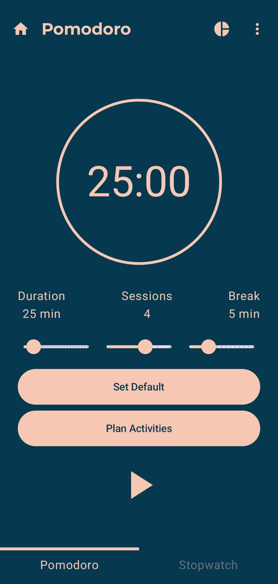
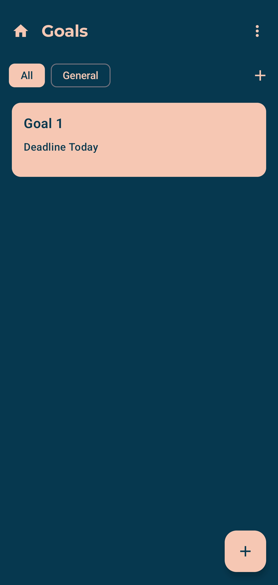

# Mind Thrive

Mind Thrive is an Android productivity and wellbeing application developed as a master's thesis project.

The app combines everyday planning, focus sessions, habits and personal goals in one place.

## Features

- **Home** — overview of daily activities and progress
- **Calendar** — organize and review scheduled activities
- **Tasks** — create and manage tasks
- **Notes** — quick note-taking with autosave
- **Focus** — Pomodoro-based focus sessions
- **Habits** — track recurring habits and progress
- **Goals** — define and monitor personal goals

## Tech Stack

- **Language** — Kotlin
- **UI** — Jetpack Compose
- **Architecture** — MVVM
- **Local storage** — Room + DataStore
- **Background work** — WorkManager

## Architecture

The application follows the **MVVM (Model–View–ViewModel)** architecture, with separate UI, data and business logic layers.

## Project

Developed as part of the master's thesis at **FERIT Osijek**.

## Screenshots

| Home | Time Management | Tasks |
| :---: | :---: | :---: |
|  |  |  |

| Focus | Goals |
| :---: | :---: |
|  |  |

